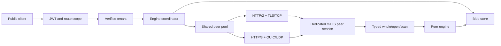

# M127 architecture and cost review

Verification status is authoritative in [VERIFIED.md](VERIFIED.md). This review
separates implementation bounds from measured performance; no cloud latency or
cloud RSS result is claimed here.

Public credentials stop at the coordinator. The tenant in each peer command
travels over an authenticated encrypted channel. A deployment peer certificate
grants internal authority across tenants. Operators must use a dedicated peer CA;
ordinary public credentials do not confer peer authority. The removed public
part route cannot invoke the peer service.

The protocol uses one typed MessagePack schema on both transports. It preserves
query/score bits and the existing one-exchange vector and two-exchange text
semantics. A failed peer still costs time and local recomputation. Healthy
distributed search and wrong-CA fallback have matching-result controls on both
transports; successful phase counters distinguish remote execution from fallback.

| Resource or operation | Bound or behavior | Evidence/status |
|---|---|---|
| Authentication/source authorization | Zero added blob operations or bytes | Refusal spies and authorized source controls pass |
| Peer application phases | Whole: one; text: open then scan | Existing phase/round-budget fixtures pass after migration |
| Connections | 64 per Api, incoming plus outgoing, both protocols | Shared admission control passes a mixed-direction/protocol test |
| Peer-list changes | Reuse the same pool and limits | Immutable Api resources; old query snapshots cannot create independent caps |
| Application receive buffers | 64 MiB shared for incoming MessagePack frames | Byte admission precedes payload allocation; permits survive dispatch |
| MessagePack frame | 32 MiB, exact one frame, depth 64 | Prefix, fragmentation, trailing-data and cancellation controls pass |
| Receive flow-control credit | 64 KiB per stream, 256 KiB per connection | H2 SETTINGS/WINDOW_UPDATE observed; both transports transfer larger payloads |
| Concurrent work | 256 incoming handlers, 256 outgoing requests; 64 streams per connection | Explicit admission and native stream multiplexing; no RPC-wide connection mutex |
| Decoded HTTP headers | 8 KiB | Configured on both stacks; raw H3 qualification passes |
| Encoded H3 control/header frames | 32 KiB early bound in both directions | Length-only wire control observed red, then passed; client refusal and all prefix splits pass |
| 0-RTT | Disabled | TLS configuration controls; no replay path for held-part scans |
| UDP unavailable | Auto probes H3, then H2; cached backoff | Actual H2 fallback and probe-count controls pass |
| Certificate failure | No transport retry; local search fallback | Trust/SAN/expiry and fallback controls pass |
| RPC lifetime | One client deadline includes queue/DNS/handshake/body; server work expires | Stalled-handler control observed red, then passed on H2 and H3 |

These are separate resource classes. The application receive-buffer cap is not a
total process-memory claim: TLS/QUIC state, flow-control buffers, HTTP headers,
decoded payloads and engine state also consume memory. Across 64 connections,
the advertised connection receive credit totals at most 16 MiB; credit is a
protocol limit, not an RSS measurement. Benchmarking must record actual memory
and allocator costs rather than treating those limits as measured residency.

Cold connections pay TCP/TLS or QUIC negotiation before useful RPC work. Warm
channels reuse those costs and multiplex independent requests. The measurement
campaign reports cold and warm cases separately. UDP loss is injected by dropping
actual QUIC datagrams in a loopback relay, with an otherwise identical relay
control; it must not be described as a TCP packet-loss experiment.

The changed-deadline control observed red, then passed after probe budgets began
using the current RPC deadline following local admission. The standalone process
also proved both encrypted listeners and Unix SIGTERM cleanup. Component tests
alone would not have proved main's wiring. The pre-advisory tree passed full
all-feature fast gates, rustdoc and independent implementation review. The
current Quinn/Tokio patches and maintained PEM parser pass the advisory gate,
99 selected regressions and strict server Clippy. The subsequent classifier
control observed remote TLS alerts being treated as availability failures, then
passed after only explicit availability-close codes could permit a retry.
All 83 library tests, eleven bad-mutation controls and all-feature workspace
tests pass. Clean coverage passes both 95% floors at 96.56% lines / 95.01%
regions after test-only additions; final fast gates and delta review passed.
[MEASURE.md](MEASURE.md) records the refreshed transport campaign on that correction
and separates it from the earlier matched TCP_NODELAY finding. That socket
fix reduced H2 cold RPCs from 45.643 ms to 0.683 ms and large RPCs from
161.349 ms to 0.574 ms on the earlier tree. Those loopback results do not establish
cloud latency or a universal H2/H3 ordering.
